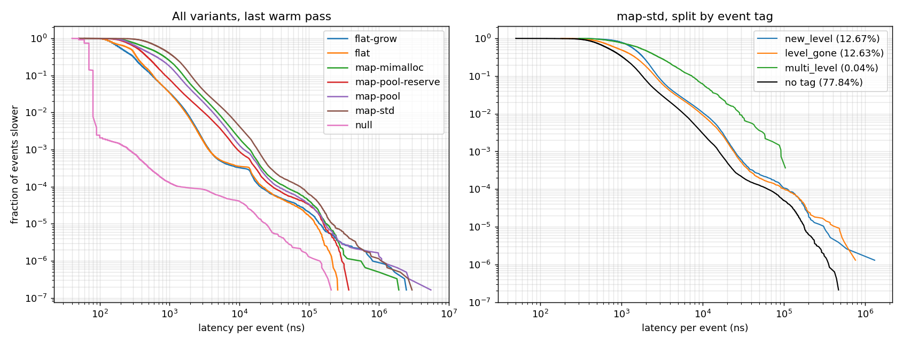
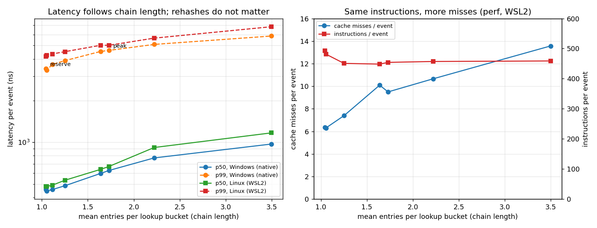

# orderbook-tail-forensics

Where do the slow events in a limit order book come from?

This project replays one full day of real Nasdaq order flow through six order book engines and times every single event. Each event is tagged with what it did inside the book: created a price level, grew a hash table, swept several levels, and so on. That makes it possible to ask which kinds of work dominate the slowest 0.1% of events, and which engineering changes actually move them.

**Hypothesis:** tail latency in a matching engine is driven by memory allocation and data layout, not by the matching logic itself.

**Short answer:** mostly yes, but layout matters far more than allocation. Hardware counters show why: allocators cost instructions, while layout costs cache misses, and misses dominate. Table growth only affects the single worst events. Hash load factor matters a lot, because longer chains add cache misses without adding instructions. Beyond the slowest 1 in 10,000 events, you are measuring the operating system, and under WSL2, the hypervisor.



## Data

> The raw inputs are not in this repository. [DATA.md](DATA.md) records exactly which files were used, with sizes and fingerprints, and how to re-fetch them.

One trading day of Nasdaq TotalView-ITCH 5.0 (30 Dec 2019, 3.5 GB compressed, 268.7M messages) from Nasdaq's public sample server. `itch_extract` keeps five heavily traded names, AAPL, MSFT, AMZN, TSLA and QQQ, which gives **6.1M book events**.

ITCH reports executions against resting orders but never the incoming order that caused them. The extractor groups consecutive executions with the same symbol, side and timestamp, and replays each group as one aggressive **sweep**. A reference book checks that a price-time-priority sweep would fill exactly the orders Nasdaq reported. When it would not (hidden liquidity, auction crosses), the group is written as per-order executions instead. So the replayed book never drifts from Nasdaq's.

| symbol | adds | deletes | replaces | sweeps | executions reproduced by sweep | unknown-order refs |
|---|---:|---:|---:|---:|---:|---:|
| AAPL | 698,744 | 654,457 | 96,968 | 40,315 | 97.9% | 0 |
| MSFT | 576,026 | 548,858 | 54,873 | 18,805 | 93.8% | 0 |
| AMZN | 232,975 | 221,826 | 54,500 | 10,517 | 95.6% | 0 |
| TSLA | 228,513 | 202,913 | 58,161 | 27,335 | 97.4% | 0 |
| QQQ | 1,111,822 | 1,096,529 | 109,274 | 13,922 | 94.5% | 0 |

## Engines

| variant | design |
|---|---|
| `map-std` | Textbook: `std::map` of levels, `std::list` FIFO per level, `std::unordered_map` id index, default heap |
| `map-mimalloc` | Same containers, all nodes from mimalloc |
| `map-pool` | Same containers, all nodes from a fixed-size free-list pool |
| `map-pool-reserve` | As `map-pool`, id index pre-sized so it never rehashes |
| `flat` | Price ladder array around the day's reference price, intrusive lists of pooled nodes addressed by `uint32` index, open-addressing id index, two-level bitmap to find the best price. All memory preallocated |
| `flat-grow` | As `flat`, but the node pool and id index start tiny and double on demand |
| `null` | Does nothing. Measures the timer and OS noise floor |

All engines are cross-checked by a differential fuzz test (1M random events with stub quotes, sub-penny prices and forced table growth). Two planted bugs were both caught at the first comparison. Every benchmark run also checks that all variants end the day in the same state.

## Results

AMD Ryzen 7 7735HS, Windows 11, on AC power with the Balanced plan, GCC 16.2 `-O3 -march=native`. The thread is pinned to one core at high priority. Each variant is replayed 6 times with the passes interleaved across variants. Pass 0 is cold; the table shows the 5 warm passes (30.5M events per variant). Latency is per event and includes about 60 ns of timer overhead (see `null`).

Warm passes, pinned to core 6 ([results/cpu6/summary.csv](results/cpu6/summary.csv)):

| variant | p50 | p99 | p99.9 | p99.99 | max | p99.9 vs map-std |
|---|---:|---:|---:|---:|---:|---:|
| null | 71 ns | 81 ns | 0.3 µs | 1.8 µs | 0.36 ms | |
| map-std | 832 ns | 6.7 µs | 18.4 µs | 79 µs | 10.9 ms | |
| map-mimalloc | 566 ns | 5.0 µs | 14.3 µs | 44 µs | 8.7 ms | -23% |
| map-pool | 416 ns | 4.3 µs | 11.7 µs | 37 µs | 6.4 ms | -37% |
| map-pool-reserve | 366 ns | 3.2 µs | 9.2 µs | 30 µs | 0.45 ms | -50% |
| flat-grow | 223 ns | 1.7 µs | 3.6 µs | 20 µs | 5.2 ms | -81% |
| flat | 283 ns | 1.7 µs | 3.6 µs | 20 µs | 0.42 ms | -80% |

The full benchmark was run three times (twice on core 2, once on core 6). p50 through p99.9 agree within about 10% across all runs. A fourth run in a later session ([results/win-cpu6-rerun](results/win-cpu6-rerun/summary.csv)) was about 30% slower at the median for every engine while `null` was unchanged, so the machine's memory latency drifts between sessions. The ranking held. Variants are always compared within one run, where passes are interleaved.

## Findings

1. **Layout is the big lever, allocation a smaller one.** Changing only the allocator (default heap to a pool) cuts p99.9 by 37%. Changing the data layout cuts it by 80%, and the flat book is 3 to 5 times faster than `map-std` at every percentile up to p99.9.

2. **Table growth sets the worst case, not the tail percentiles.** Growth events are 0.0009% of all events. Each one lands in the tail (540 times over-represented), but together they are only about 0.5% of the p99.9 tail. `flat` and `flat-grow` are identical through p99.99; only the max differs (0.42 ms vs 5.2 ms). Preallocating also costs something: `flat-grow` has the *better* median (223 vs 283 ns), probably because its smaller index stays in cache.

3. **The slow events are the ones that touch cold memory.** In every design, events that create a price level are about 2 times over-represented in the p99.9 tail. Replaces are about 3 times over-represented, and sweeps across several levels 23 to 35 times. The flat book allocates nothing when it creates a level and still shows the same pattern. So the cost is cache misses on untouched memory, not the allocation call itself.

4. **Matching is not the bottleneck.** Sweeps are 1.8% of events and about 9% of the flat book's tail. They are slower than average, but they are not where the tail comes from.

5. **Below 1 in 10,000, the tail belongs to the machine.** p99.99 is 2.5 times higher on core 2 than core 6 for *every* variant, including `null`. The survival curves of all variants bend into the same shape around 10⁻⁴. `hiccup`, a thread that only spins and reads the TSC, shows why: it loses 4.7% of its time on core 2 and 1.7% on core 6, in about 1,000 to 1,400 interruptions per second (median 13 µs). Engine claims here stop at p99.9.

## Follow-up 1: why pre-sizing the hash index helps

Pre-sizing the `unordered_map` cut p99.9 by another 21%, yet rehashes are only 0.5% of the tail. Two explanations were possible: rehash stalls, or a lower load factor (shorter bucket chains, so fewer scattered nodes visited per lookup). To separate them, the same pooled book was run at max load factors from 0.125 to 4, plus a variant pre-sized to exactly the day's peak, which never rehashes but runs near load factor 1. An untimed replay measured the chain length a lookup actually sees, averaged over the day.



Windows, core 6 ([results/lf-cpu6/chains.csv](results/lf-cpu6/chains.csv)):

| variant | chain length | rehashes per pass | p50 | p99 | p99.9 |
|---|---:|---:|---:|---:|---:|
| max load 0.125 | 1.05 | 60 | 446 ns | 3.3 µs | 8.6 µs |
| pre-sized, 2¹⁸ ids | 1.04 | **0** | 456 ns | 3.4 µs | 8.9 µs |
| max load 0.25 | 1.11 | 60 | 456 ns | 3.6 µs | 9.4 µs |
| max load 0.5 | 1.25 | 60 | 486 ns | 3.9 µs | 10.2 µs |
| default (max load 1) | 1.64 | 57 | 596 ns | 4.5 µs | 12.3 µs |
| pre-sized to the day's peak | 1.73 | **0** | 626 ns | 4.6 µs | 12.3 µs |
| max load 2 | 2.22 | 56 | 771 ns | 5.1 µs | 14.9 µs |
| max load 4 | 3.50 | 56 | 972 ns | 5.9 µs | 16.5 µs |

**It is the load factor.** Latency rises with chain length at every percentile. Removing all rehashes while keeping long chains (pre-sized to peak) changes nothing. Keeping 60 rehashes per pass with short chains (max load 0.125) matches the pre-sized table. The same ordering reproduces under Linux with GCC 13.

## Follow-up 2: hardware counters

`perf stat` under Linux (WSL2, which exposes the CPU's hardware counters). Every variant ran the same 3 passes as `null`, and `null` was subtracted, so these are the hardware costs of the book work alone, per event ([results/perf/per_event.csv](results/perf/per_event.csv)). Seven events share the counters, so perf scales multiplexed counts.

| variant | cycles | instructions | IPC | L1d misses | cache misses | dTLB misses | branch misses |
|---|---:|---:|---:|---:|---:|---:|---:|
| flat-grow | 504 | 155 | 0.31 | 4.5 | 2.8 | 0.41 | 2.6 |
| flat | 636 | 150 | 0.24 | 4.2 | 3.3 | 0.78 | 1.9 |
| map, pre-sized 2¹⁸ | 1,195 | 493 | 0.41 | 16 | 6.4 | 0.72 | 5.4 |
| map, max load 0.125 | 1,267 | 482 | 0.38 | 15 | 6.3 | 0.85 | 5.5 |
| map, max load 0.5 | 1,387 | 451 | 0.33 | 16 | 7.4 | 0.87 | 5.9 |
| map-pool (max load 1) | 1,787 | 449 | 0.25 | 17 | 10.0 | 1.86 | 6.5 |
| map, pre-sized to peak | 1,792 | 454 | 0.25 | 19 | 9.5 | 1.91 | 6.4 |
| map-mimalloc | 1,886 | 510 | 0.27 | 18 | 9.9 | 1.28 | 6.8 |
| map, max load 2 | 2,033 | 457 | 0.22 | 20 | 11 | 1.46 | 6.5 |
| map-std | 2,123 | 705 | 0.33 | 22 | 12 | 2.10 | 7.1 |
| map, max load 4 | 2,682 | 459 | 0.17 | 22 | 14 | 2.07 | 6.6 |

- **Load factor costs memory misses, not work.** From max load 0.125 to 4, instructions stay flat (about 460 per event) while cache misses more than double (6.3 to 14) and IPC halves.
- **Allocators cost instructions, layout costs misses.** The default heap adds about 250 instructions per event over the pool (malloc and free code), with a modest change in misses. The flat book needs a third of the instructions and about half the cache misses of the best map book.
- **This explains flat-grow's faster median.** It has fewer cache misses (2.8 vs 3.3) and half the dTLB misses (0.41 vs 0.78) of the preallocated flat book. Its smaller tables stay resident.

## Follow-up 3: Linux under WSL2

The plan was to re-run on Linux, expecting less OS noise. The only Linux available on this machine without rebooting is WSL2, a Hyper-V virtual machine. Same code, GCC 13.3, thread pinned to vCPU 6 at nice -20 ([results/linux-cpu6](results/linux-cpu6/summary.csv)):

| variant | p50 | p99 | p99.9 | p99.99 |
|---|---:|---:|---:|---:|
| null | 71 ns | 263 ns | 0.7 µs | 58 µs |
| map-std | 812 ns | 6.7 µs | 74 µs | 8.0 ms |
| map-pool-reserve | 466 ns | 4.5 µs | 46 µs | 1.9 ms |
| flat | 386 ns | 2.1 µs | 8.7 µs | 0.43 ms |

Medians and the ranking match Windows. The tail is far worse: every survival curve ends in the same cliff at about 11 ms ([tails](results/linux-cpu6/tails.png)).

**The Linux guest is not running for most of the time, and cannot tell.** Inside the guest, the benchmark thread had almost no context switches (36 to 69 per minute-long run), no extra page faults in the timed loop, and zero steal time. Linux believes the thread ran for the entire run. But the hardware cycle counter advanced at only 0.5 to 0.7 GHz on a 3.2 GHz core, and `hiccup` measures the gaps directly: inside WSL2 a spinning thread loses **48 to 60%** of wall-clock time, with p99 gaps of about **11 ms**. Native Windows loses 1.7 to 4.7%. The Windows host is descheduling the virtual CPU for a full scheduler slice, and Hyper-V does not report it to the guest as steal.

Practical consequences: WSL2 is fine for counting instructions and cache misses (the counters only run while the guest runs), and its medians are trustworthy. Its tail latencies are not. Clean Linux tail numbers need bare metal. Also, `replay_bench` calibrates the TSC against the clock over 300 ms, and in the WSL2 load-factor run it read 3.035 GHz instead of 3.194, probably because a stall landed in that window. Nanoseconds in that one run are about 5% low; comparisons inside it are unaffected.

## Reproduce

Requires GCC (tested with WinLibs GCC 16.2 UCRT), CMake 3.24 or newer, Ninja, and Python with numpy and matplotlib for the plot. CMake fetches mimalloc v2.1.7.

```bash
cmake -S . -B build -G Ninja -DCMAKE_BUILD_TYPE=Release
cmake --build build
./build/test_books

curl -L -o data/raw/12302019.NASDAQ_ITCH50.gz "https://emi.nasdaq.com/ITCH/Nasdaq%20ITCH/12302019.NASDAQ_ITCH50.gz"
gzip -dc data/raw/12302019.NASDAQ_ITCH50.gz | ./build/itch_extract data/events5.bin AAPL,MSFT,AMZN,TSLA,QQQ

./build/replay_bench data/events5.bin --passes 6 --cpu 6 --out results/cpu6 --dump
python analysis/plot_tails.py results/cpu6

# load-factor sweep (also writes chains.csv)
./build/replay_bench data/events5.bin --passes 6 --cpu 6 --out results/lf-cpu6 \
  --variants null,map-pool-lf0.125,map-pool-lf0.25,map-pool-lf0.5,map-pool,map-pool-lf2,map-pool-lf4,map-pool-peak,map-pool-reserve

# Linux only: hardware counters per variant, then per-event table
for v in null map-std map-pool flat; do
  perf stat -x, -e cycles,instructions,cache-references,cache-misses,L1-dcache-load-misses,dTLB-load-misses,branch-misses \
    -o results/perf/$v.csv -- ./build/replay_bench data/events5.bin --passes 3 --cpu 6 --out /tmp/x --variants $v --no-probe
done
python analysis/perf_table.py results/perf results/linux-cpu6 results/linux-lf-cpu6

# machine noise: 10 s spin on core 6, report gaps over 2 us
./build/hiccup 10 6 2000
```

## Layout

```
include/lob/   types, MapBook, FlatBook, IdIndex, PoolAlloc, histogram, TSC timing, event file I/O
tools/         itch_extract: ITCH 5.0 to event stream, with sweep reconstruction and validation
               hiccup: measures how often and how long a pinned spinning thread stops running
bench/         replay_bench: per-event TSC timing, cold/warm passes, tail attribution, hash chain probe
tests/         directed tests and a differential fuzz across all engines
analysis/      survival curves, chain-length chart, perf counter table
results/       per run: summary.csv, attribution.csv, meta.csv, chains.csv, tails.png; perf/ counters
```
